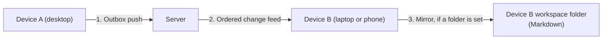

---
covers:
  - apps/web/src/features/offline-sync
  - apps/web/src/features/offline-sync/domain/sync-scope.ts
  - apps/web/src/features/offline-sync/ui/sync-loop.tsx
  - apps/web/src/features/offline-sync/ui/sync-status-indicator.tsx
  - apps/web/src/features/offline-sync/ui/sync-issues-panel.tsx
  - apps/web/src/features/workspace/application/auto-sync.ts
  - apps/web/src/features/workspace/ui/git-sync-dot.tsx
  - crates/wf-core/src/sync
checked: 2026-11-17
---
# How your work is stored and synced

This page covers where your work lives, what syncs, when it syncs, and what the
app does when two copies disagree. Only behaviour that the code on this branch
shows is described here.

> Your notes sync to your own private GitHub repository. GitHub holds your
> synced files; the WeaveForge server only relays live shared sessions.

That sentence is the intended onboarding wording. The onboarding screen that
shows it is **not on this branch** (`feat/091-gh-autosync`), so do not read it
as shipped behaviour here.

Two things move, on different paths:

| what | where it lives | how it travels |
| --- | --- | --- |
| **Your writing**: notes, papers, the logbook, plans | the app's local database, plus a Markdown mirror in your workspace folder | the folder is written locally; the server carries it through account sync |
| **The database itself** | `<your workspace folder>/.weaveforge/db` when the app finds it there, otherwise WeaveForge's own data directory | never synced as a file; only its contents travel |

## One folder

The mirror writes one folder per project, with the app's own bookkeeping kept in
a `.weaveforge/` directory inside it:

```
<your chosen folder>/
├── <project>/
│   └── .weaveforge/
│       └── mirror.json           this computer's record of its last write (not synced)
└── .weaveforge/
    └── db/                       the local database, when it is kept in the folder
```

Backups are written to WeaveForge's own data directory (`local-db-backups`), not
into the folder. See [the workspace folder](workspace-folder.md) for the full
layout.

## The Markdown mirror

Your writing is stored in the local database first. Writing the Markdown files
is a separate, one-way, best-effort follow-up: save something in the app and the
folder catches up a moment later. A folder that cannot be written (disk full,
permission revoked, drive unplugged) does not take your save down with it.

Reading folder edits back in is not automatic. On desktop the app watches the
folder and reports when something out there changed; it does not apply the change
by itself.

Every file carries a `weaveforge-id` in its frontmatter, and that id, not the
filename, is the identity. Rename a note in Finder and it is the same note.

### A note or canvas edited in two places

When the same note or canvas is changed in two places before the two have agreed,
the app keeps both: the other copy is kept beside it as a conflict copy, so
nothing is silently overwritten. Open the copy, move across what you want, and
delete it. A canvas works the same way, and its copy is a canvas. See
[canvas](canvas.md).

A canvas in the workspace folder has one extra case. It is matched to its canvas
through `.weaveforge/canvas-ids.json`. If that file cannot be read, the canvases
are held, not imported, and the conflict card says to repair or remove the file.

### Conflicts in the folder

A file changed in the folder and in the app is a conflict when the pull reaches
it. Conflicts are listed under **Needs you** in Settings, with the fields that
collided. Nothing is written over until you choose which copy to keep.

### The folder and GitHub

On the desktop app, a folder with a git remote and a token syncs with it by
itself: about 10 seconds after a folder commit, at start, every 5 minutes, when
you come back to the window, and when the network comes back. A dot shows
**Synced**, **Syncing…**, **Offline** or **Sync failed** with **Retry**. See
[Syncing with GitHub on its own](workspace-folder.md#syncing-with-github-on-its-own).

## Syncing to your account

Account sync is a separate path from the GitHub folder sync above. Everything
in the app works with the network off; account sync carries changes only when
the network is there.

- **Every write is recorded locally first.**
- **Writes are queued in an ordered outbox**, each with an idempotency id the
  server de-duplicates on, so an operation whose fate is unknown after a dropped
  connection can be sent again safely.
- **A cycle pushes, then pulls.**
- **The pull reads a change feed** ordered by the server's sequence number. The
  device remembers how far it has read, and that watermark only moves forward.

### When it runs

Sync runs while the app is open, on these triggers:

1. **When you start the app.** If that start-up sync fails, it is retried after
   30 seconds.
2. **Every 45 seconds**, to catch a connection that dropped without an event.
3. **When the window regains focus**, if the last run was at least 15 seconds ago.
4. **1.5 seconds after a local change.**
5. **When the network comes back**, as the machine reports it.

A cycle does not overlap itself: a trigger that fires during a run does not start
a second run alongside it.

### When GitHub sync is on

When the folder is connected to GitHub, the server carries only the row kinds
that have to be shared between people: shares, share links, comments and the
live-session relay (`SHARED_ROW_KINDS` in `sync-scope.ts`). Without GitHub
connected, every row kind syncs.

### Conflicts between devices

Conflicts between devices are listed under **Needs you** in Settings, and the sync
status indicator turns amber while one is waiting
(`sync-status-indicator.tsx`). Resolve each one by choosing a side.

## Syncing between devices



1. **Local first on every device.** Reading, writing and searching use the
   device's local database.
2. **Outbox push.** Each change is saved locally and appended to the outbox. When
   the device is online, the sync worker pushes the outbox to the server in order.
3. **Change feed and watermark pulls.** Other devices pull from their own last
   watermark and apply the changes to their local database.
4. **Mirroring to files.** If a device has a workspace folder, the Markdown mirror
   updates its files a moment later.

With the network off, the app keeps working on the local database. Queued
operations go up in order when the network returns.

## What is not synced

- **The database as a file.** Only its contents travel.
- **The Markdown folder as a sync channel.** It is a local mirror. Folder history
  in git is a separate option, covered in
  [the workspace folder](workspace-folder.md#keeping-a-history).
- **Your workspace choice.** Which folder you picked is a property of this
  machine.

## Known scope limits

- The onboarding wording at the top of this page is not on this branch.
- What works offline beyond the local database (PDFs, graphs) is not covered here.
- Which folder you picked does not sync between machines.

## Related

- [The workspace folder](workspace-folder.md): the mirror, in detail.
- [Collaborative editing](collaborative-editing.md): two people in one document.
